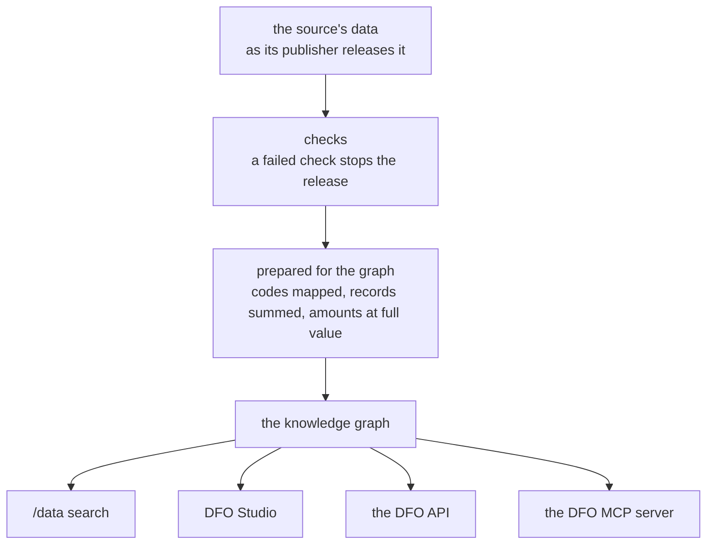

# Where the numbers come from

Every number in the DFO comes from a file published by an official source, such as the OECD, World Bank, or IMF. The DFO keeps the original values, adds up individual aid records into totals, and gives each country and category one consistent label so that data from different sources can be combined. It checks for new releases daily, and every figure can be traced back to its source file.

## How data enters the DFO

Every figure in the DFO starts as data its source publishes. The DFO downloads that data, checks it, prepares it, and loads the result into one [knowledge graph](knowledge-graph.md). That one graph serves search on [/data](/data), DFO Studio, the DFO API, and the DFO MCP server, so the same question returns the same numbers on every interface.

The examples on the rest of this page use the OECD's Creditor Reporting System (CRS), which records each aid activity donors report.

## What the DFO changes and preserves

The Transformation Log on each source's page on [Sources](/data/sources) lists every change the DFO makes to that source, for example the [CRS's](/data/sources/provenance/OECDCreditorReportingSystem?tab=log).

Each pipeline keeps only the rows its source's figures should be built from, leaving out series outside the DFO's scope and rows that would count the same money twice. For the CRS, that means excluding donors' core contributions to multilateral organisations (`bi_multi` 2), which the multilateral reports again when it spends it.

Each source's codes map to shared concepts, so the same country or purpose has one identifier across sources. In the CRS, purpose 12220 becomes `CRSPurposeCode12220`, and OECD Development Assistance Committee (DAC) donor code 4 becomes `country/FRA`. [The development finance ontology](ontology.md) explains how a source code becomes a graph identifier and where to look up codes.

Some sources, such as the CRS, report individual records, one row per activity with the agency, channel and project behind it. The graph holds one number per series and year, not one per project, so the DFO sums the records that share every coded column, such as year, donor, recipient and purpose. France's basic health care grants to Togo in a year are one figure in the graph, however many projects France reported. Record-level details, such as the agency, channel and project, stay in the source.

Commitments, gross disbursements and grant equivalents pass through as the CRS reports them. Net disbursements subtract amounts received back from gross disbursements, so a record with a repayment but no disbursement gives a negative figure. Amounts received don't appear on their own.

The graph stores amounts at their full value, scaling up any source that reports in thousands or millions, so amounts from different sources can be compared directly. The CRS reports in millions, so 1.5 in the CRS file is 1,500,000 in the graph.

Currency and prices stay as the source reports them, so the stored number is the one the source published. For the CRS, that is current US dollars. Any conversion is a separate step the DFO applies only on request, and [Methods](methods.md) explains how.

Series from Data Commons' own imports, such as the World Bank's World Development Indicators, don't pass through these steps. Their provenance begins `dc/base/`, and [Methods](methods.md) shows how to read it.

## How to check a figure against its source

Start with the source's page on [Sources](/data/sources). It states the date the DFO downloaded the release now in the graph, the URL of the source data file, and a link to the publisher's own page for the data.

Take a [snapshot link](../build/share.md) from /data. It records the exact version of the rows behind the figure, so you compare against the release the DFO used.

For a CRS figure:

1. Download the CRS file from the source data URL on its page on [Sources](/data/sources).
1. Drop rows with `bi_multi` 2.
1. Keep the rows that match the figure's year, donor, recipient and every CRS code in its StatVar.
1. Sum the column for the figure's measure: `usd_disbursement` for gross disbursements, `usd_commitment` for commitments, `usd_grant_equiv` for grant equivalents, or `usd_disbursement` minus `usd_received` for net disbursements.
1. Multiply by a million.

The result matches the DFO figure within rounding. For other sources, follow the same steps with that source's codes and columns.

## How fresh the data is

Each source publishes on its own calendar; its update cadence can be viewed on the [Sources](/data/sources) page.

The DFO checks each source regularly for a new release. It reads the publisher's release marker, such as the version on the OECD's CRS bulk file or the release date of the IMF's World Economic Outlook. A changed marker triggers the pipeline to download the data, rerun its checks and models, and rebuild the files the graph loads. A failed check stops the update, so the graph keeps the previous release.

The rebuilt files are then loaded into the graph. A [live link](../build/share.md) reruns the question against the graph, so it shows the new release as soon as the graph holds it. A snapshot link reads the version it recorded, so it retains the numbers it had.

## What you can inspect yourself

The ontology is public. Every concept the graph uses, from a purpose code to a type of finance, is an item in the [development finance Wikibase](https://developmentfinance.wikibase.cloud/wiki/Main_Page). Each item gives the concept's definition, its place in the hierarchy and the source code it represents. [The development finance ontology](ontology.md) explains how the items are organised.

The packages the pipelines use to fetch sources are open source. The OECD's DAC statistics, including the CRS, come through the [ODA reader](../../oda_reader/index.md), and you can run the same `bulk_download_crs` call yourself. The IMF's World Economic Outlook comes through the [IMF reader](../../imf-reader/index.md). [DCP tools](../../dcp-tools/index.md) writes the files the graph loads.

## Next

- [The knowledge graph](knowledge-graph.md) follows the 2008 French grant to Togo from its CRS row to a graph observation, column by column.
- [Versions and snapshots](versions.md) explains the snapshot link to cite and the ids that reproduce the exact rows in code.
